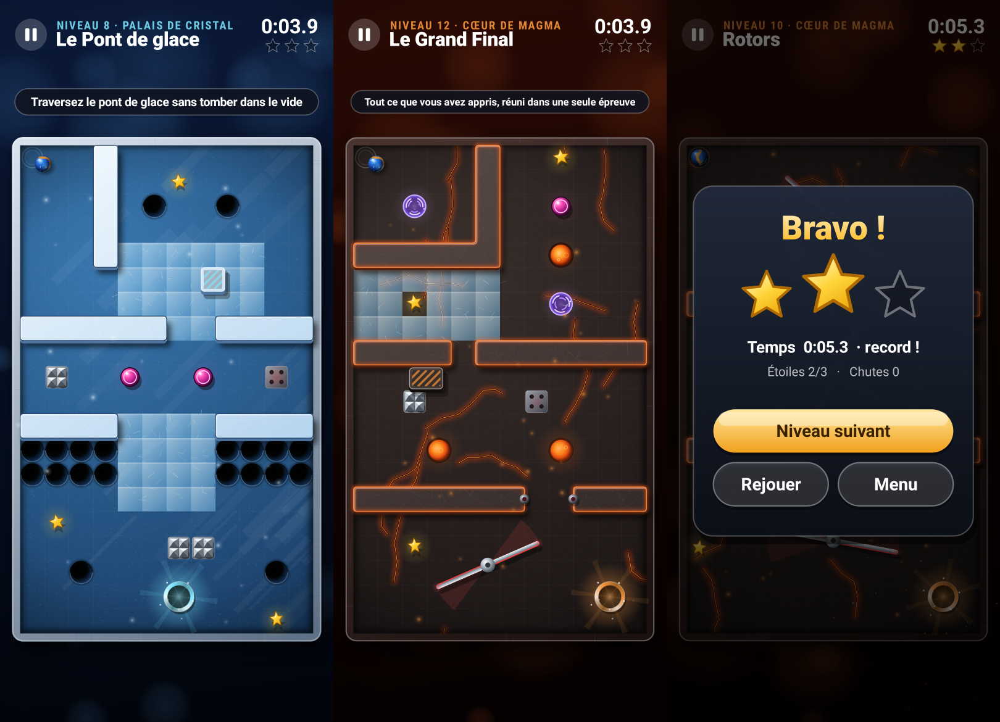
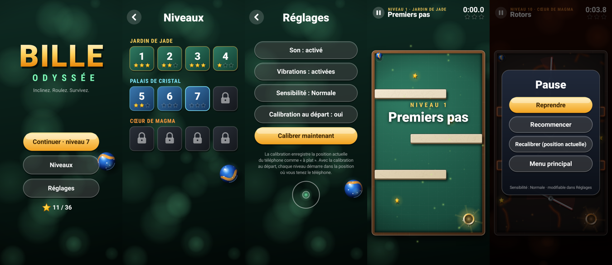

# Bille Odyssée

Jeu Android d'adresse : inclinez le téléphone pour guider une bille de verre jusqu'au trou doré,
en évitant trous, pics, lasers, rotors et murs mobiles.

**APK prêt à installer : [`BilleOdyssee.apk`](BilleOdyssee.apk)** (Android 7.0 et plus).




## Contenu

- 12 niveaux répartis en 3 mondes, chacun avec son ambiance :
  *Jardin de Jade* (marbre et bois), *Palais de Cristal* (glace et acier), *Cœur de Magma* (basalte et lave).
- Pièges et éléments : trous, champignons rebondissants, boue, glace, accélérateurs, pics rétractables
  annoncés par une lueur rouge, téléporteurs, murs mobiles qui écrasent, lasers intermittents, rotors à lames.
- 3 étoiles à ramasser par niveau, chronomètre et records, niveaux déverrouillés au fur et à mesure.
- Bille en verre rendue en 3D (le motif roule réellement selon le déplacement), ombres, halos,
  particules, traînée de vitesse, lucioles / flocons / braises selon le monde.
- Sons synthétisés à la volée et vibrations.
- Réglages : son, vibrations, sensibilité (douce / normale / vive), calibration de l'inclinaison
  (automatique au départ de chaque niveau, ou manuelle depuis la pause).

## Compiler

Aucun Gradle ni SDK Android complet n'est nécessaire :

```bash
sudo apt install openjdk-17-jdk aapt zipalign apksigner dalvik-exchange
./build.sh          # vérifie les niveaux, compile et signe BilleOdyssee.apk
```

## Organisation

```
src/com/mika/bille/
  Level.java, Levels.java   grille 12 x 20 des niveaux (légende dans Level.java) et objets animés
  World.java                physique de la bille et règles (sans dépendance Android)
  Renderer.java             rendu du plateau (pré-calculé) et des éléments animés
  GameView.java             boucle de jeu, accéléromètre, menus, interface
  Sfx.java                  effets sonores synthétisés
tools/LevelCheck.java       vérifie que chaque étoile et l'arrivée sont accessibles et que la physique est stable
tools/make_icon.py          génère l'icône
```
